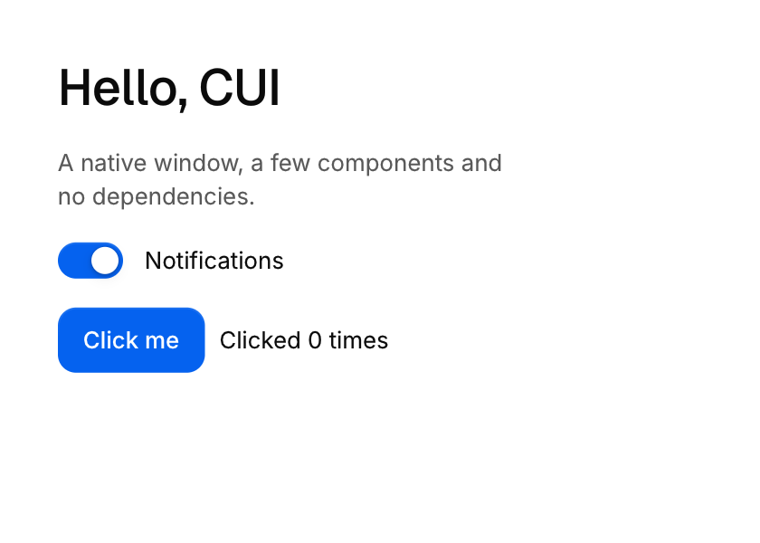
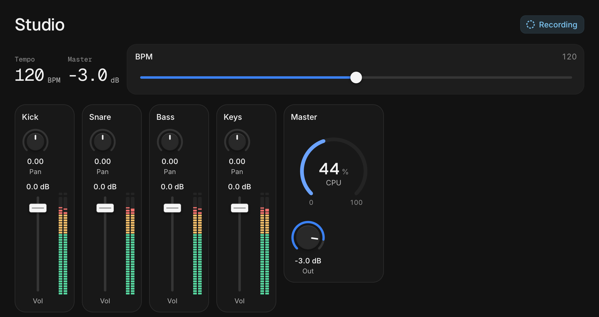
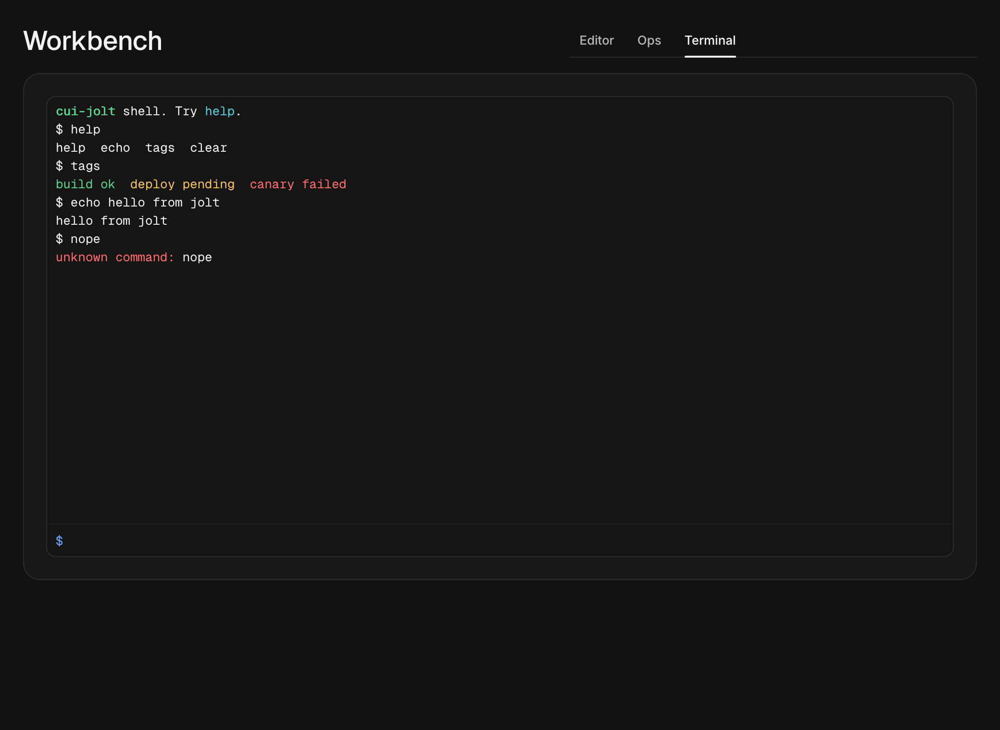
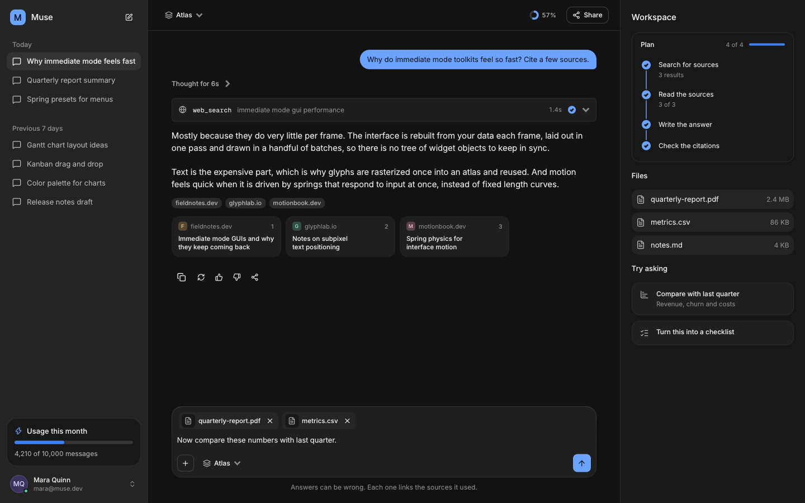

# cui-jolt

[CUI](https://github.com/yappologistic/CUI) (about 150 native UI components for C) from
[Jolt](https://jolt-lang.net) (Clojure on Chez Scheme). The whole C API is bound: 521
functions, 336 structs, 94 enums, 168 icons and 40 container macros, all generated from
CUI's headers.


```clojure
(ns hello
  (:require [cui.core :as ui]))

(def notifications (atom true))
(def clicks (atom 0))

(defn frame [u]
  (ui/column u {:pad 32 :gap 16}
    (ui/heading u "Hello, CUI" 2)
    (ui/secondary u "A native window, a few components and no dependencies.")
    (ui/switch u "Notifications" notifications)
    (ui/row u {:gap 8}
      (when (ui/button u "Click me" {:variant :primary})
        (swap! clicks inc))
      (ui/textf u "Clicked %d times" @clicks))))

(defn -main [& _]
  (ui/run {:title "Hello" :width 420 :height 300} frame))
```



## Quick start

You need [Jolt](https://jolt-lang.net/docs/getting-started.html), CMake and a C compiler.
On Linux you also need the X11 headers (`libx11-dev`).

```sh
jolt native       # clone CUI and build native/libcui as a shared library
jolt hello        # run examples/hello.clj
jolt dashboard    # run examples/dashboard.clj
jolt studio       # run examples/studio.clj
jolt devtools     # run examples/devtools.clj
jolt assistant    # run examples/assistant.clj
jolt test         # value and interaction tests, no display needed
```

Run these from this directory: `jolt` finds its tasks in `deps.edn` here.

`jolt native` clones CUI's latest commit. The bindings in `src/` were generated from
CUI `a8f71c0`. If a newer CUI has changed its headers, run `jolt gen` after `jolt native`.

## Examples

| | |
|---|---|
| `hello` | A switch, a button and formatted text. |
| `dashboard` | Metrics with sparklines, line and donut charts, a settings form, a dialog and toasts. |
| `studio` | A mixer: knobs, faders, animated level meters, a radial gauge, readouts and a step slider. |
| `devtools` | Three tabs. A code editor with a live markdown preview. A candlestick chart, status tags and a cron field that describes its schedule. A terminal with ANSI colors and a few built-in commands. |
| `assistant` | A port of CUI's own [`assistant.c`](https://yappologistic.github.io/CUI/#/app/assistant): a chat app with reasoning, tool calls, a plan, sources, a model picker and a composer. Sending a message plays a scripted answer. The layout adapts to the window width. |







To use it from your own project, add this repo's `src` to your paths and declare the
library in your `deps.edn`, as this repo does:

```clojure
:jolt/native [{:name "cui"
               :linux  ["native/libcui.so" "libcui.so.1" "libcui.so"]
               :darwin ["native/libcui.dylib" "libcui.dylib"]}]
```

Outside a `deps.edn` project, set `CUI_LIB=/path/to/libcui.so` before requiring `cui.core`.

## From C to Jolt

CUI's C API is built from named-argument macros and `for`-loop scopes. Both have a
direct Jolt counterpart, so CUI's own [component docs](https://yappologistic.github.io/CUI/)
translate line for line.

| C | Jolt |
|---|---|
| `cui_button(ui, "Save", .variant = CUI_BUTTON_PRIMARY)` | `(ui/button u "Save" {:variant :primary})` |
| `cui_row(ui, .gap = 8) { ... }` | `(ui/row u {:gap 8} ...)` |
| `cui_dialog(ui, "Title", &open) { ... }` | `(ui/dialog u "Title" open {} ...)` |
| `bool on; cui_switch(ui, "Wifi", &on)` | `(def on (atom true)) (ui/switch u "Wifi" on)` |
| `char buf[256]; cui_input(ui, "id", buf, sizeof buf)` | `(def name (atom "")) (ui/input u "id" name)` |
| `cui_tabs(ui, "t", items, 3, &idx)` | `(ui/tabs u "t" ["A" "B" "C"] idx)` |
| `.icon = CUI_ICON_PLUS` | `{:icon :plus}` |
| `.width = CUI_FILL`, `CUI_PX(120)`, `CUI_PCT(50)` | `{:width :fill}`, `120`, `[:pct 50]` |
| `.color = CUI_COLOR_ACCENT`, `CUI_RGB(0x6366F1)` | `{:color :accent}`, `0x6366F1`, `"#6366f1"` |
| `cui_set_theme(ui, CUI_THEME_DARK)` | `(ui/set-theme u :dark)` |
| `cui_shortcut(ui, CUI_MOD_PRIMARY, CUI_KEY_K)` | `(ui/shortcut u :primary :k)` |

The rules behind the table:

- **Names.** `cui_foo` and `cui_foo_ex` become `foo`, with the context handle first.
- **Options** are a map, always last and always optional. Keys are the C field names in
  kebab case (`:pad-x`). Snake case also works, and an unknown key throws an error that
  lists the valid ones.
- **Enums** are keywords: the C names minus their shared prefix (`CUI_BUTTON_PRIMARY` is
  `:primary`, `CUI_ACCENT_BLUE` is `:blue`). Integers still work.
- **Colors** can be a theme token (`:accent`, `:text-secondary`, `:series-2`, …), `0xRRGGBB`,
  `"#rrggbb"` or `"#rrggbbaa"`, `[r g b]` or `[r g b a]`, or a map. Tokens follow the theme
  and accent the way `CUI_COLOR_*` does.
- **Sizes** can be `:fit`, `:fill`, a number of points, `[:grow w]` or `[:pct p]`.
- **Icons.** Any string position takes an icon keyword. Use `(ui/icon-str :plus)` to splice
  an icon into a label. `ui/icons` lists them all.
- **Out-parameters are atoms.** For `bool*`, `int*`, `float*`, `double*`, `cui_date*`,
  `cui_color*` and text buffers, CUI reads the atom's value, and whatever CUI changes is
  written back after the call. An atom holding a vector maps to a C array: toggle groups,
  multi-selects, and `prop-vec` as `(atom [x y z])`. Struct atoms are maps, e.g.
  `(atom {:year 2026 :month 11 :day 20})` for a date picker.
- **Arrays plus counts** are one collection. Counts inside option structs are filled in
  for you: `{:spark [1 2 3]}` also sets `spark_count`.
- **Containers** are macros: `(ui/row u opts body...)`. Conditional ones (`dialog`,
  `popover`, `menu`, `accordion`, `tree`, …) run their body only while open, like
  `CUI__SCOPE_IF`. The begin and end functions are also exported (`row-begin`, `box-end`)
  for early exits.
- **Struct returns are maps.** For example, `(ui/last-rect u)` returns `{:x :y :w :h}`.
- **printf-style functions** format in Clojure: `(ui/textf u "%d items" n)`.

For a large text area, `(ui/text-buffer 65536 "initial")` keeps one C buffer instead of
copying an atom's string every frame.

The terminal widget keeps its scrollback in C memory that must outlive every frame, so it
cannot live in an atom. `(ui/terminal-buffer)` allocates it once (64 KB of text and 2,048
lines by default; pass `text-cap line-cap` to change them) and returns a pointer. Use that
pointer instead of `terminal-init`:

```clojure
(defonce term (ui/terminal-buffer))
(ui/terminal-write term "\u001b[32mready\u001b[0m\n")   ; ANSI colors work

(defn frame [u]
  (when-let [cmd (:command (ui/terminal u "term" term {:prompt "$ " :height 300}))]
    (ui/terminal-write term (str "you typed " cmd "\n"))))
```

Any struct out-parameter accepts a raw pointer like this one. CUI then uses that memory
directly, and nothing is copied.

Everything is also available exactly as in C, in `cui.raw`. That namespace has every
function, enum constant and icon under its C name (`raw/cui_button_ex`, `raw/CUI_KEY_K`,
`raw/CUI_ICON_PLUS`).

## Apps, frames and memory

`(ui/run desc frame-fn)` opens the window and calls `frame-fn` once per frame until the
window closes. `desc` takes `cui_app_desc`'s fields: `:title :width :height :min-width
:min-height :fixed-size :continuous :no-vsync :hidden :renderer :theme :accent
:follow-system-theme`. The loop is event driven, so an idle app sleeps.
`(ui/with-app [u desc] body...)` is the same with a body instead of a function.
`(ui/quit!)` closes the app.

Each frame gets its own arena (a block of memory freed all at once). All option structs,
strings, arrays and out-parameter cells for that frame are allocated there. A frame's
arena is freed only after the *next* frame has been presented, because CUI may still read
a pointer (a tooltip's text, say) while it paints the frame it was passed in. Nothing is
allocated per call outside the arena, and nothing leaks.

CUI calls made outside `run`, such as setup code, should be wrapped in `(ui/with-frame ...)`.
Unwrapped calls still work, but their memory lives as long as the process does. If you
drive CUI with your own window, renderer and input (CUI's
[integration guide](https://github.com/yappologistic/CUI/blob/master/docs/integration.md)),
the shape is:

```clojure
(def u (ui/create {:theme :dark}))
(ui/set-viewport u width height scale)
;; each frame: feed input (ui/input-mouse-move, ui/input-key, ...), then
(ui/with-frame
  (ui/begin-frame u dt)
  (my-frame u)
  (ui/end-frame u)
  (render (ui/get-draw-data u)))
```

This is also how `test/interaction_test.clj` drives CUI without a display.

## How it is built

`gen/gen.py` preprocesses `cui.h` and `cui_app.h`, parses them with pycparser, and writes:

- `src/cui/raw.clj` has one `defcfn` per C function, plus enum constants and icons. By-value
  structs (`cui_color`, `cui_vec2`, …) use `[:by-value ...]` descriptors.
- `src/cui/spec.clj` has an `ffi/layout` per struct, a kind for every field, and keyword
  maps for every enum.
- `src/cui/core.clj` is the prelude in `gen/core_prelude.clj`, then one wrapper per
  function and one macro per scope macro.

`src/cui/impl.clj` is hand-written. It is the runtime that reads the generated field kinds
and converts values to and from C memory. To track a new CUI version, run `jolt native`
and then `jolt gen`. Regeneration is deterministic.

## Tests

- **`jolt test`** runs two suites. `values-test` covers coercions, struct round trips, the
  auto-filled counts and the error messages. `interaction-test` feeds real mouse, keyboard
  and text input to CUI between frames and checks the results: switches, buttons, tabs and
  text fields update their atoms, untouched float atoms stay put, a dialog's open flag
  is cleared by Escape, and a command typed into a terminal comes back exactly once.
- **`test/layout_check.sh /path/to/CUI`** compiles a C program that prints `sizeof` and
  `offsetof` for every struct, and diffs that against Jolt's layouts. All 2,277 values match.
  It needs `pycparser`.
- **`test/screenshot.clj`** renders any frame function in a hidden window to an RGBA file.
  The images in `docs/images` were made with it under Xvfb at `CUI_SCALE=2`.

## Status and limitations

- **Tested platforms.** Tested on Linux x86-64 (X11, software renderer) with Jolt 0.8.24
  and CUI `d6c7761`, and on macOS arm64 (Cocoa) with Jolt 0.8.23 and CUI `a8f71c0`. Types
  map from their C names (`uint32_t`, `size_t`, …) and every layout comes from Jolt's own
  ABI layout, so nothing is hard-coded to one platform. Windows has not been run.
  Re-run `test/layout_check.sh` there first.
- **Callbacks.** `cui_app_run` is replaced by `ui/run`, which needs no callback.
  Function-pointer fields (a custom renderer, platform or allocator interface, a canvas
  paint function) are passed through as raw pointers. Make one with `jolt.ffi/callback` if
  you need it.
- **Skipped function.** `cui_log_appendv` takes a `va_list` and is not bound. Use
  `(ui/log! buf :info "fmt" args...)` with a `(ui/log-buffer)` instead.
- **Static binaries.** `jolt build` loads `libcui` dynamically. Linking it statically would
  also need CUI's platform libraries (X11 and GL) on the link line, which is not configured.
- **CUI's own limitations** apply: no screen-reader tree yet, and no complex-script shaping.

MIT, like CUI.
